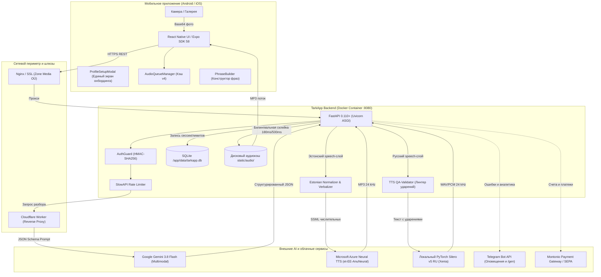
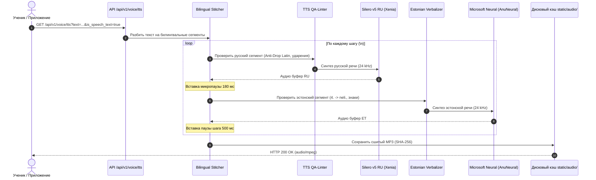

# ТЕХНИЧЕСКИЙ ПАСПОРТ ПРОГРАММНОГО КОМПЛЕКСА TARKAPP

**Дата составления:** 13 ноября 2026 г.  
**Версия документа:** 2.1.0  
**Статус продукта:** Closed Beta / Release Candidate  
**Юрисдикция и оператор:** Tark Systems OÜ (Reg: 16987456, Таллинн, Эстонская Республика)

---

## 1. ОБЩИЕ СВЕДЕНИЯ И ПАСПОРТИЗАЦИЯ СИСТЕМЫ

| Параметр | Значение |
| :--- | :--- |
| **Полное наименование ПО** | Программный комплекс персонализированной адаптации школьников «TarkApp» (Tark Õpetaja) |
| **Назначение** | Адаптационный карманный тьютор для русскоязычных школьников 1–12 классов в Эстонии при переходе на 100% эстоноязычное обучение. Помогает преодолеть языковой барьер при изучении математики, природоведения, физики и других предметов по эстонским учебникам (Opiq, Koolibri, Avita). |
| **Текущая версия ПО** | Единая версия программного комплекса **v1.4.3** (Mobile Client build `versionCode: 6`, Backend API `v1.4.3`) |
| **Репозиторий** | `https://github.com/danilvorontsov-cell/TarkApp.git` (ветка `main`, HEAD: `715178b`) |
| **Среда развёртывания** | Боевой сервер `185.31.243.124` (Zone Media OÜ, Таллинн, Эстония) |
| **Архитектурный паттерн** | Client-Server (REST API + WebSocket/Polling) с гибридной облачно-локальной обработкой нейросетей |

---

## 2. АРХИТЕКТУРНАЯ ТОПОЛОГИЯ И ОНБОРДИНГ УЧЕНИКА

### 2.1. Единый экран первичной регистрации и профиля (Onboarding & Profile Setup)
В версии v1.4.3 полностью устранён разрыв между первичным онбордингом и экраном настроек профиля:
- **Единая форма:** Компонент `ProfileSetupModal.tsx` объединяет выбор аватара, ввод имени/никнейма, интерактивную сетку 1–12 классов (с автоматическим делением на 4 возрастных тира: Primary 1–3, Middle 4–6, High 7–9, Gymnasium 10–12), текстовое поле увлечений и блок динамических подсказок «Быстрые подсказки по возрасту» (`AGE_SUGGESTIONS`).
- **Режим онбординга (`isOnboarding = true`):**
  - Скрываются второстепенные сервисные блоки («Выйти из профиля», «Лицензия и подписка», «Удаление данных»).
  - Фиксированный футер (sticky bottom) с кнопкой **«🚀 Начать обучение»** с гарантированным нижним отступом `useSafeAreaInsets().bottom` для защиты от наложений системной 3-кнопочной панели навигации Android.
  - Динамическое обновление дефолтов и чипсов при переключении класса с безусловным сохранением пользовательского ввода (`hasCustomInterests = true`).
  - Мгновенное применение выбранных интересов в первом же запросе разбора учебника `/api/v1/analyze-page/json` без повторного всплытия формы.
- **Фонетическая защита игровых брендов и хобби в TTS:** В `tts_qa_validator.py` и `tts_stress_dict.json` внедрён Anti-Drop Filter для Silero v5 с расстановкой ударений для ключевых брендов из увлечений школьников: *Minecraft* (`Майнкр+афт`), *LEGO* (`Л+его`), *Roblox* (`Р+облокс`), *Brawl Stars* (`Бр+авл Ст+арс`), *CS:GO* (`Кэ-Эс Гоу`), *Valorant* (`Валор+ант`), *TikTok* (`Тикт+ок`), *YouTube* (`Ют+уб`), *AI* (`Эй-Ай`).



---

## 3. СТЕК ТЕХНОЛОГИЙ

### 3.1. Мобильный фронтенд (Mobile Client)
- **Фреймворк:** React Native `0.88.0` / Expo SDK `58.0.16`
- **Рантайм & Язык:** React `19.3.0`, TypeScript `~6.0.3`
- **Мультимедиа & Звук:** `expo-audio` `^58.0.10`, `expo-image-picker` `~58.0.10`, `expo-image-manipulator` `^58.0.15`
- **Локальное хранилище & Безопасность:** `@react-native-async-storage/async-storage` `2.2.0`, `expo-secure-store` `^58.0.2`
- **Мониторинг сбоев:** `@sentry/react-native` `~8.28.0`
- **Система сборки:** Android Gradle Plugin 8.x, Java 17, компиляция релизных APK (`./gradlew assembleRelease`).

### 3.2. Серверный бэкенд (Backend Core)
- **Фреймворк:** FastAPI `0.110.0+`, Python `3.11-slim`, Uvicorn ASGI
- **Валидация данных:** Pydantic `v2.6+`, Pydantic Settings `v2.2+`
- **ORM & Хранилище:** SQLAlchemy `2.0+`, SQLite3 (с WAL-режимом и журналированием)
- **Сетевой клиент:** HTTPX `0.27+` (асинхронные пулы с пулингом соединений)
- **Ограничение частоты:** SlowAPI `0.1.9` (композитный ключ `IP + Device_ID`)
- **Обработка аудио:** PyTorch `2.0+` (CPU-optimized), SoundFile `0.12.1`, SciPy `1.11+`, NumPy `1.26+`, edge-tts `7.0+`

---

## 4. БАЗА ДАННЫХ И СХЕМА ДАННЫХ (SQLITE)

База данных располагается в постоянном томе: `/app/data/tarkapp.db` (на хосте: `/home/ubuntu/tarkapp/backend/data/tarkapp.db`).

### 4.1. Таблица `devices` (Устройства и лицензионный статус)
```sql
CREATE TABLE devices (
    device_id VARCHAR PRIMARY KEY,          -- Хеш идентификатора устройства (Android/Expo ID)
    first_seen_at DATETIME DEFAULT CURRENT_TIMESTAMP,
    trial_expires_at DATETIME NOT NULL,     -- Дата истечения пробного периода
    has_active_access BOOLEAN DEFAULT 1,    -- Флаг допуска к сервису
    activated_key VARCHAR NULL,             -- Активированный ключ (TARK-XXXX-XXXX)
    free_reviews_left INTEGER NOT NULL,     -- Оставшиеся разборы на текущий день
    max_free_reviews INTEGER NOT NULL,      -- Дневная квота (10 для prod, 20 для closed_beta)
    last_review_date VARCHAR NULL,          -- Дата последнего списания (YYYY-MM-DD для сброса)
    total_reviews_used INTEGER DEFAULT 0    -- Сквозной счетчик выполненных разборов
);
```

### 4.2. Таблица `access_keys` (Лицензионные ключи доступа)
```sql
CREATE TABLE access_keys (
    key_code VARCHAR PRIMARY KEY,           -- Код ключа (формат TARK-XXXX-XXXX)
    duration_days INTEGER DEFAULT 30,       -- Срок действия подписки в днях
    is_used BOOLEAN DEFAULT 0,              -- Флаг погашения ключа
    used_by_device VARCHAR REFERENCES devices(device_id),
    created_at DATETIME DEFAULT CURRENT_TIMESTAMP,
    used_at DATETIME NULL
);
```

### 4.3. Таблица `invoices` (Счета и оплата)
```sql
CREATE TABLE invoices (
    id INTEGER PRIMARY KEY AUTOINCREMENT,
    invoice_number VARCHAR UNIQUE NOT NULL, -- Номер счета (INV-YYYY-XXXXXX)
    viitenumber VARCHAR NOT NULL,           -- Эстонский банковский референс-код (алгоритм 7-3-1)
    device_id VARCHAR NULL,
    customer_email VARCHAR NOT NULL,
    payer_name VARCHAR NULL,
    plan_id VARCHAR NOT NULL,               -- monthly, quarterly, school_year
    amount VARCHAR NOT NULL,                -- Сумма в EUR (например, 9.99)
    currency VARCHAR DEFAULT 'EUR',
    is_paid BOOLEAN DEFAULT 0,
    pdf_path VARCHAR NULL,
    created_at DATETIME DEFAULT CURRENT_TIMESTAMP,
    paid_at DATETIME NULL
);
```

### 4.4. Таблица `tts_audit_logs` (Персистентный аудит синтеза речи)
```sql
CREATE TABLE tts_audit_logs (
    id INTEGER PRIMARY KEY AUTOINCREMENT,
    created_at DATETIME DEFAULT CURRENT_TIMESTAMP,
    endpoint VARCHAR NOT NULL,              -- /api/v1/voice/tts
    device_id VARCHAR NULL,
    is_speech_text BOOLEAN DEFAULT 0,
    incoming_text TEXT NOT NULL,            -- Исходный сырой текст
    final_ssml TEXT NULL,                   -- Итоговый SSML / сегменты склейки
    has_accents BOOLEAN DEFAULT 0,
    has_estonian BOOLEAN DEFAULT 0,
    status VARCHAR DEFAULT 'SUCCESS',       -- SUCCESS, FAILED, TIMEOUT
    error_message TEXT NULL,
    cache_status VARCHAR NULL,              -- RAM_CACHE, DISK_CACHE, SILERO_SYNTHESIS
    duration_ms FLOAT NULL                  -- Полное время генерации аудиопотока в мс
);
```

---

## 5. ИНТЕЛЛЕКТУАЛЬНОЕ ЯДРО (MULTIMODAL AI PIPELINE)

### 5.1. Модель и каналы вызовов
- **Базовая модель:** Google Gemini 3.8 Flash (`gemini-3.8-flash`).
- **Сетевой шлюз:** Запросы к Gemini API направляются через Cloudflare Worker Reverse Proxy, что исключает блокировки IP-адресов эстонского дата-центра Zone Media со стороны Google AI Studio.
- **Гарантия схемы:** Вызовы выполняются с `response_schema=GeminiPageAnalysisSchema` и `response_mime_type="application/json"`.

### 5.2. Функциональные режимы
1. **Режим A: Õppija (Школьный учебник):**
   - Анализ математических примеров, уравнений, геометрических фигур и текстовых условий.
   - **Сократический метод:** категорический запрет на выдачу готового ответа к заданию из книги. Формируется параллельный обучающий пример (*Näidis / worked_example*) с вымышленными числами.
   - **Грамматический каркас (*answer_template*):** эстонское предложение с ключевыми словами в квадратных скобках `[слово]`, которое ребенок собирает самостоятельно.
2. **Режим B: Maailma Avastaja (Исследователь мира):**
   - Активируется при загрузке фото окружающего мира (игрушки, животные, техника, еда, растения, улицы).
   - Связывает объект с интересами ученика (Minecraft, LEGO, спорт, рисование) и формирует живой школьный мини-рассказ на эстонском языке.

### 5.3. Двухуровневая архитектура данных (Dual-Layer Architecture)
- **Визуальный слой (Display Layer):**
  Поля `theme_explanation`, `how_to_answer`, `worked_example` (`given`, `steps`, `note`). Отображаются на экране в строгой литературной орфографии. В визуальном слое строго запрещены плюсы ударения, спецтеги или фонетические пометки.
- **Речевой слой (Speech Layer):**
  Поля `theme_explanation_speech`, `how_to_answer_speech`, `worked_example_speech`. Специально нормализованы для голосовых движков:
  - Любые цифры (0–9) заменены полными словами на соответствующем языке.
  - Математические знаки (`+`, `-`, `·`, `:`, `=`) раскрыты в естественную речь (*плюс*, *минус*, *korda*, *jagatud*, *võrdub*).
  - Эстонские фрагменты изолированы тегами `<est>...</est>`.
  - В русских омографах проставлены знаки контекстного ударения `+` перед ударными гласными.
  - Между шагами решения установлены переносы `\n` для обеспечения пауз тишины.

### 5.4. Матрица возрастной адаптации (Age Tiers)
| Звено (Tier) | Классы | Ограничение аудио | Sentence Frame (Конструктор фраз) | Характер подсказок |
| :--- | :--- | :--- | :--- | :--- |
| **PRIMARY** | 1–3 (Algkool) | Полный аудиогид без ограничений | Включен с геймификацией | Игровой, аналогии с Minecraft/LEGO |
| **MIDDLE** | 4–6 (Põhikool I) | Полный аудиогид без ограничений | Включен со словарным банком | Дружелюбный, баланс теории и практики |
| **HIGH** | 7–9 (Põhikool II) | Русская и билингвальная озвучка отключены (`audio_disabled: true`). Чисто эстонская озвучка (`lang="et"`, `bilingual=false`) разрешена до 600 символов | Включен | Сжатый, алгоритмический |
| **GYMNASIUM** | 10–12 (Gümnaasium) | Русская и билингвальная озвучка отключены (`audio_disabled: true`). Чисто эстонская озвучка (`lang="et"`, `bilingual=false`) разрешена до 600 символов | Отключен | Строгий научный и академический стиль |

---

## 6. ГИБРИДНЫЙ РЕЧЕВОЙ КОМПЛЕКС (BILINGUAL HYBRID TTS)

Программный комплекс объединяет локальную русскую нейросеть и облачный эстонский синтез в единый монолитный аудиопоток.



### 6.1. Русский речевой тракт (Silero v5)
- **Модель:** `v5_ru.pt` (PyTorch, инференс на CPU, время загрузки $\approx 1$ сек, время синтеза предложения $\approx 180$–300 мс).
- **Голос:** `xenia` / `kseniya` (24 000 Гц).
- **Фонетический валидатор (`tts_qa_validator.py`):**
  1. *Anti-Drop Filter:* перехватывает бренды и термины на латинице, вырезаемые моделью Silero (LEGO $\rightarrow$ `Л+его`, Minecraft $\rightarrow$ `Майнкр+афт`, Roblox $\rightarrow$ `Р+облокс`, YouTube $\rightarrow$ `Ют+уб`).
  2. *Словарь ударений (`tts_stress_dict.json`):* автоматическая простановка знака `+` перед ударной гласной.
  3. *Орфоэпия порядковых шагов:* гарантированное устранение архаизма «Шаг вторый» $\rightarrow$ «Шаг втор+ой», «п+ервый», «тр+етий», «четв+ёртый».
  4. *Омографы действий:* «вычит+аем», «ст+опы».
  - *Задержка валидации:* $< 1.5$ мс (чистые регулярные выражения и хеш-таблицы без сетевых вызовов).

### 6.2. Эстонский речевой тракт (Microsoft Neural TTS)
- **Голос:** `et-EE-AnuNeural` (Azure Speech SDK, региональный эндпоинт: `northeurope`; автономный fallback: `edge-tts`).
- **Эстонский нормализатор и вербализатор чисел (`tts_normalizer.py`):**
  - **Защита от сбоя порядковых числительных:** В эстонской грамматике точка после цифры (`4.`) означает порядковое числительное (*neljas* — четвертый). При математическом высказывании на конце предложения (`Liidetavad on 8 ja 4. Leia summa.`) модуль вербализует цифры в слова `kaheksa ja neli.`, исключая чтение *«neljas»*.
  - **Числительные:** полный диапазон от 0 до 999 999 (*üks, kaks, kolm, neli, viis, kuus, seitse, kaheksa, üheksa, kümme, üksteist, kaksteist...*).
  - **Падежные дефисы:** сохранение форм типа `5-ga` (*viiega*), `10-ni` (*kümneni*), `3-st` (*kolmest*).
  - **Единицы измерения:** `km` $\rightarrow$ *kilomeetrit*, `m²` $\rightarrow$ *ruutmeetrit*, `cm³` $\rightarrow$ *kuupsentimeetrit*.
  - **Дроби:** `1/2` $\rightarrow$ *üks kahendik*, `3/4` $\rightarrow$ *kolm neljandikku*.

### 6.3. Механизм склейки и кэширования звука
- **Микропауза смены языка:** ровно **180 мс** тишины между русскими и эстонскими сегментами.
- **Межшаговая пауза:** ровно **500 мс** тишины между отдельными шагами алгоритмов решения задачи.
- **RAM-кэш:** потокобезопасный LRU-кэш на 500 записей для мгновенного ответа на частые фразы.
- **Дисковый кэш:** директория `/app/static/audio/cache/` (ключ: `SHA-256(voice + clean_text)`). Лимит размера диска: 2000 файлов / 1.5 ГБ с автоматической LRU-ротацией.
- **Дедупликация in-flight:** предотвращение повторных синтезов при одновременных параллельных запросах одного текста.

---

## 7. БЕЗОПАСНОСТЬ, АВТОРИЗАЦИЯ И РЕЙТ-ЛИМИТЫ

### 7.1. Аутентификация устройств и сессий
- Клиент при первом запуске регистрирует уникальный идентификатор устройства `X-Device-ID`.
- Сервер выдает подписанный сессионный токен HMAC-SHA256 (`Authorization: Bearer <device_id>:<signature>`).
- В открытые системные логи идентификатор устройства записывается строго в маскированном виде (например, `df4c...7b3c`).
- Запрещен любой неавторизованный DEV-байпас в продакшн-режиме (`APP_ENV=production`).

### 7.2. Защита от перегрузок и атак (Rate Limiting)
- Реализована через `SlowAPI` по композитному ключу `${IP}:${device_id}`:
  - `/api/v1/voice/tts` — **60 запросов/мин** на устройство, **120 запросов/мин** на IP.
  - `/api/v1/license/activate` — **5 запросов/мин** на устройство (защита от брутфорса ключей).
  - `/api/v1/analyze-page/json` — **15 запросов/мин** на устройство.
- При превышении отдается статус `HTTP 429 Too Many Requests` с дружелюбным объяснением на русском языке.

### 7.3. HTTP Security Headers
Middleware `SecurityHeadersMiddleware` инжектирует заголовки безопасности в каждый HTTP-ответ:
- `X-Content-Type-Options: nosniff`
- `X-Frame-Options: DENY`
- `X-XSS-Protection: 1; mode=block`
- `Strict-Transport-Security: max-age=31536000; includeSubDomains`
- `Referrer-Policy: strict-origin-when-cross-origin`

### 7.4. GDPR-комплаенс
- Поддержка полного стирания цифрового следа пользователя: метод `DELETE /api/v1/license/device` удаляет запись устройства, историю разборов, сессии и неоплаченные черновики счетов.
- В соответствии с Законом Эстонии о бухгалтерском учёте (*Raamatupidamise seadus § 12*), все оплаченные счета (`status='paid'`) и связанные с ними PDF-файлы инвойсов строго сохраняются в течение **7 лет**. При этом идентификатор устройства в этих счетах деперсонализируется и анонимизируется (`device_id = "GDPR_ANONYMIZED"`).

---

## 8. МОНЕТИЗАЦИЯ, ЛИЦЕНЗИРОВАНИЕ И БИЛЛИНГ

### 8.1. Управление тарифами
| Режим | Срок триала | Дневной лимит | Модель продления |
| :--- | :--- | :--- | :--- |
| **closed_beta** | 14 дней | 20 проверок/день | Бесплатно на этапе закрытого тестирования |
| **production** | 5 дней | 10 проверок/день | Ежемесячная подписка через ключ или инвойс |

### 8.2. Атомарное списание проверок
Списание дневных проверок выполняется атомарным SQL-декрементом:
`UPDATE devices SET free_reviews_left = free_reviews_left - 1 WHERE device_id = :dev AND free_reviews_left > 0`
Это исключает race conditions (состояние гонки) при параллельной отправке нескольких страниц.

### 8.3. Банковские реквизиты и счета
- **Провайдер:** Montonio API (банковские ссылки Swedbank, SEB, LHV, Luminor, Coop).
- **Банковский счет:** Coop Pank (IBAN конфигурируется в защищенном `.env`).
- **Референс-номера счетов:** алгоритм расчета контрольной суммы 7-3-1 (эстонский национальный стандарт *viitenumber*).
- **Доставка счетов:** фоновая отправка через SMTP или Resend API с вложением сгенерированного PDF.

---

## 9. ТЕЛЕМЕТРИЯ, АЛЕРТИНГ И АДМИНИСТРАТИВНЫЙ БОТ

### 9.1. Telegram-бот администратора
В бэкенд интегрирован Telegram-агент с поддержкой тем (Message Threads / Topics):
- Топик **Ошибки и баги (`BUGS`)**: стек-трейсы исключений, сбои нейросетей, HTTP 500.
- Топик **Алерты (`ALERTS`)**: предупреждения о падении скорости синтеза, приближение к лимитам диска.
- Топик **Счета (`INVOICES`)**: уведомления о создании и оплате подписок.

### 9.2. Административные команды бота
- `/gen <кол-во> <дней>` — мгновенная криптографическая генерация партии лицензионных ключей доступа (например, `/gen 5 30`).
- `/stats` — сводка по активным устройствам, числу проведенных анализов и использованному дисковому пространству.
- `/tts_last` — инспекция последнего сформированного SSML и сегментов склейки.
- `/tts_errors` — просмотр последней зафиксированной ошибки звукового движка.

---

## 10. ПАСПОРТ РАЗВЁРТЫВАНИЯ И СЕРВЕРНОЙ СРЕДЫ

| Узел / Сервис | Хост / Расположение | Порты / Доступ | Назначение |
| :--- | :--- | :--- | :--- |
| **Host OS** | Ubuntu 22.04 LTS (x86_64) | SSH (22) | Хост-система боевого сервера Zone Media |
| **Reverse Proxy** | Nginx / Cloudflare Edge | 80, 443 (HTTPS) | SSL-терминация (`api.tarkapp.ee`, `app.tarkapp.ee`) |
| **Backend Container** | `tarkapp-backend` (Docker) | `127.0.0.1:8080` | Контейнер FastAPI, Silero v5, SQLite |
| **Gemini Gateway** | Cloudflare Workers | HTTPS Outbound | Обход геоблокировок европейского дата-центра |
| **Speech Gateway** | Azure Cognitive Services | HTTPS Outbound | Облачный синтез AnuNeural (`northeurope`) |
| **Mobile Build** | Android Standalone APK | Локально / Expo | Сборка артефакта `TarkApp_v1.4.2.apk` (77 МБ) |

### Регламент обновления боевого сервера:
```bash
# 1. Подключение к серверу
ssh ubuntu@185.31.243.124

# 2. Получение актуальной версии
cd /home/ubuntu/tarkapp
git pull origin main

# 3. Инвалидация устаревшего аудиокэша
rm -rf /home/ubuntu/tarkapp/backend/static/audio/cache/*
rm -rf /home/ubuntu/tarkapp/backend/static/audio/*.mp3

# 4. Пересборка и запуск контейнера
docker compose build backend && docker compose up -d backend

# 5. Проверка статуса и логов
docker logs -f tarkapp-backend --tail 50
```

---
*Документ составлен и утвержден инженером программного комплекса TarkApp.*
